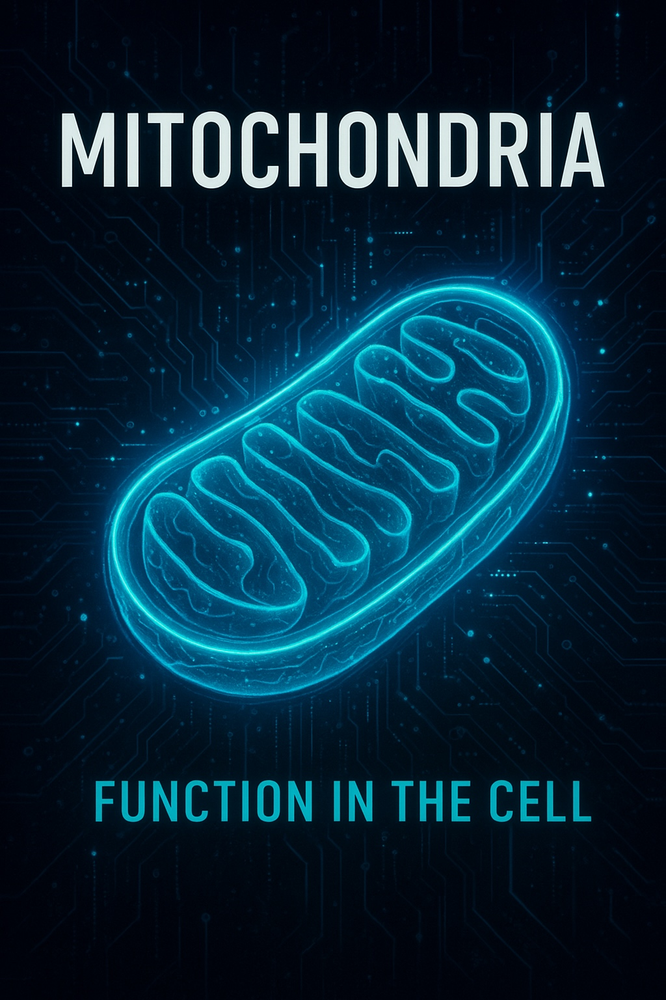

# Mitochondria

Book about mitochondria written using AI (Grok, Gemini).

## Book Summary

This comprehensive book delves into the intricate world of mitochondria, exploring their structure, function, and significance in cellular biology and human health. Written collaboratively with AI assistance, it provides an in-depth look at these essential organelles from historical discovery to cutting-edge research.

The book is structured into 13 chapters and comprehensive appendices, covering the following topics:

- **Chapter 1:** Beyond the Powerhouse: The Mitochondrial Paradigm Shift
- **Chapter 2:** Unveiling the Inner Universe: A History of Mitochondrial Science
- **Chapter 3:** The Ancient Pact: Endosymbiosis and Eukaryotic Evolution
- **Chapter 4:** Architecture at the Nanoscale: Membranes, Cristae, and Supercomplexes
- **Chapter 5:** The Currency of Life: Bioenergetics, Chemiosmosis, and Metabolic Flux
- **Chapter 6:** The Signaling Hub: Calcium, Metabolites, Stress Responses, and Cell Fate
- **Chapter 7:** The Second Genome: Mitochondrial DNA, Peptides, and Epigenetics
- **Chapter 8:** The Dynamic Network: Biogenesis, Fission, Fusion, Mitophagy, and Intercellular Transfer
- **Chapter 9:** Exercise, Metabolic Flexibility, and Specialized Tissues
- **Chapter 10:** Brain Energy, Neurodegeneration, and Metabolic Psychiatry
- **Chapter 11:** Immunity, Inflammation, Infection, and Cancer
- **Chapter 12:** When the Powerhouse Fails: Primary Mitochondrial Diseases and Diagnostics
- **Chapter 13:** Rejuvenating the Inner Universe: Aging, Longevity, and Frontier Therapeutics
- **Appendices:** Glossary, Bioenergetic Pathways, Leading Researchers & Landmark Studies, and Clinical Resources

## Prompts

- We are going to write a book about mitochondria. Plan all the chapters based on all the science you know in plan.md. (Grok)
- Write each chapter in its own Markdown file following plan.md. (Grok)
- Review chapter 1 to 13. Correct each chapter with all the science facts you know for sure and go in depth as much as you can. (Gemini)
- Review the current book science and update it to the latest findings based on studies and doctors who know about mitochondria. Change structure of chapters or even chapters themselves if you have to. (Gemini 4 Argon)
